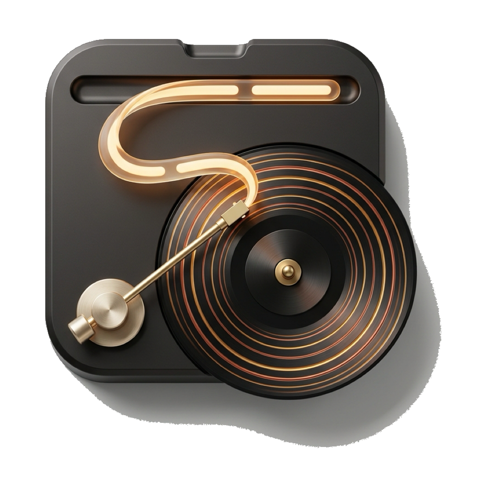
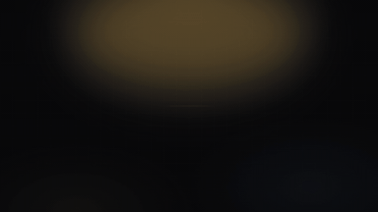

<p align="center">
  
</p>

<h1 align="center">BarTune</h1>

<p align="center">
  <strong>Real-time karaoke lyrics in your macOS menu bar — tucked cleanly to the left of the MacBook notch.</strong><br/>
  Zero window overlap. Zero accounts or API keys. Built natively in Swift.
</p>

<p align="center">
  <a href="https://github.com/TrigrD3/bartune/releases/latest"></a>
  <a href="https://github.com/TrigrD3/bartune/actions/workflows/ci.yml"></a>
  <a href="https://github.com/TrigrD3/bartune/actions/workflows/codeql.yml"></a>
  <a href="https://github.com/TrigrD3/bartune/actions/workflows/secret-scan.yml"></a>
  <a href="https://coderabbit.ai"></a>
  <br/>
  
  
  <a href="LICENSE"></a>
</p>

<p align="center">
  
</p>

---

## Why BarTune?

Most desktop lyrics apps float over your editor, browser tabs, or terminal. **BarTune** lives strictly inside the unused menu bar space to the left of your MacBook notch (`NSScreen.auxiliaryTopLeftArea`), smoothly sweeping lyrics in sync with your music — and instantly stepping aside the moment your cursor hovers over app menus.

## Highlights

- **Tucked beside the notch.** BarTune occupies only the unused menu bar space to the left of your MacBook notch (`NSScreen.auxiliaryTopLeftArea`), so it never floats over your editor, browser, or terminal.
- **Steps aside on hover.** Pick **Cursor Spotlight** to peek only the menu item under your pointer, or **Hide Entire Bar** to reveal the full app menu bar on hover.
- **Works across desktop and web players.** Tracks **Spotify** and **Apple Music** natively, and falls back to **YouTube Music, Spotify Web, SoundCloud, and Apple Music Web** in Chrome, Arc, Brave, Edge, or Safari. Ordinary **YouTube** videos (including Chapters) are opt-in.
- **Word-level karaoke sync and audio alignment.** Pulls millisecond **NetEase YRC** lyrics with **LRCLIB** fallback, and can optionally align lyrics to the playing audio using **Lyrics Alignment**, which aligns the fetched lyrics to the audio on the Neural Engine instead of transcribing them (Apple silicon; Settings downloads its 274 MB model, a Core ML conversion of Meta's MMS forced-aligner licensed CC BY-NC 4.0, built by `scripts/convert-lyrics-aligner.py`; it keeps every line it aligns confidently, later plays listen only for the lines still missing, and the sync badge shows Synced once every line is aligned). Lyrics Alignment refines its word timings with the captured vocal waveform: held notes keep a word lit until the singer lets go, words placed in silence are dropped, and a line the model heard less clearly is still kept when the voice comes in right where it starts. With **Syllable Timing** on, it sweeps each syllable on its own note (Korean, Chinese and Latin-script lyrics; Japanese stays word by word). Synced timings are cached on disk so repeat plays load without recalculating, with a toggleable sync badge in the lyrics bar.
- **Translation and offline romanization.** Translate lyrics into your preferred language (cached locally) or turn on offline **Japanese → Romaji**, **Korean → Romanized**, and **Chinese → Pinyin** for sing-along readability.
- **Offline cache you can inspect.** Stores fetched lyrics, translations, audio-synced timings, and per-track timing offsets locally with a configurable cache limit and a searchable **Cached Songs** list in Settings.
- **Custom themes, visualizers, and live diagnostics.** Choose from 5 visualizer styles (**Bars, Wave, Dots, Vinyl, Note**), album-art accent or backdrop themes, custom typography, Launch at Login, macOS permission status indicators, and live/average CPU and memory metrics in a 6-tab Settings window (`⌘,`), plus checksum-verified update downloads from **About**.

## Install

### Homebrew (Recommended)

Requires **macOS 13.0 (Ventura)+** on **Apple Silicon** (Intel Macs can build from source below).

```bash
brew install --cask TrigrD3/tap/bartune
```

### Build from Source

Requires **macOS 13.0 (Ventura)+** and **Swift 5.9+** (Xcode or Xcode Command Line Tools).

```bash
git clone https://github.com/TrigrD3/bartune.git
cd bartune
chmod +x build.sh
./build.sh --install
open -a BarTune
```

## Settings (`⌘,`)

BarTune runs as a lightweight menu bar utility (`LSUIElement`) with a 6-tab native macOS Settings window:

| Tab | Options |
| :--- | :--- |
| **General** | Hover Behavior (*Cursor Spotlight* + width slider, or *Hide Entire Bar*), Browser Music and Ordinary YouTube Videos toggles (with what is sent to NetEase and LRCLIB), Launch at Login, macOS Permission Status, Live & Average CPU/Memory Usage |
| **Appearance** | Color Theme (*System*, *Album Accent*, *Album Tint*), Background Opacity, Font Family, Weight, Size, Karaoke Sweep Highlight, Word Pop, Typing Caret, Line Transition (*Subtle*, *Slide*, *Blur Fade*, *Pop*, *Push*, *None*; Speed, Start Early) |
| **Visualizer** | Live Preview, Style (*Bars / Wave / Dots / Vinyl / Note*), Color Theme, Width, Animation toggle |
| **Lyrics & Sync** | Translation & Target Language, Romanization (*Japanese / Korean / Chinese*), Audio Karaoke Sync (*Off / Lyrics Alignment*, model download, syllable timing, transcribed-audio overwrite, lyrics-bar sync badge), Karaoke Precision (*Low CPU* vs *High Precision 30fps*), Per-Track Timing Offset |
| **Offline Cache** | Cached song & audio-synced counts, storage usage, cache limit, searchable **Cached Songs** list, Reveal in Finder, Clear Cache |
| **About** | Installed version, **Update Channel** (*Stable* releases or *Latest from main*), **Check for Updates**, SHA-256-verified DMG download to `~/Downloads` (open it and drag BarTune to Applications), GitHub links. Also reachable from the version label under the sidebar. |

## Permissions

- **Automation (Spotify / Apple Music / Browsers):** On first launch, macOS prompts for Automation access so BarTune can read the current track and playback position. Manage this anytime under **System Settings → Privacy & Security → Automation**.
- **Screen & System Audio Recording (Optional):** Only needed if you enable **Audio Karaoke Sync** (*Lyrics Alignment*). BarTune captures system playback audio only — never your microphone.
- **Browser Music (Optional):** To read playback from YouTube Music or web players, enable **Allow JavaScript from Apple Events** once in your browser:
  - **Chrome / Arc / Brave / Edge:** *View → Developer → Allow JavaScript from Apple Events*
  - **Safari:** *Safari → Settings → Advanced → Show features for web developers*, then *Develop → Allow JavaScript from Apple Events*

## Contributing

Contributions are welcome! See [CONTRIBUTING.md](CONTRIBUTING.md) for local setup, Conventional Commits, and testing guidelines.

## License

GNU General Public License v3.0 (GPLv3) — see [LICENSE](LICENSE).
